# SENTINEL v4.1.0 — Advanced Access Protection System

**Project Report · Usable Security & Privacy**
Department of Computer Science — Air University Islamabad, Multan Campus
Muhammad Jameel

---

## Abstract

SENTINEL is an educational Windows desktop access-protection prototype developed
as a final-year software project. The system is implemented in Python using the
Tkinter GUI framework and demonstrates core access-control concepts: password-based
authentication, progressive account lockout, automated intruder capture via webcam,
and real-time email alerting.

The application provides a multi-step setup wizard, a full-screen login interface
with **PBKDF2-HMAC-SHA256** password storage, a progressive lockout mechanism that
doubles the timeout with each repeated failure (15 seconds up to a 30-minute cap),
and an integrated dashboard for monitoring security events, reviewing captured
intruder photographs, and managing system settings.

SENTINEL is not a replacement for operating-system-level authentication. It works
at the application layer and serves as a demonstration of practical security
concepts: adaptive password hashing, lockout policy, credential protection at rest,
event logging and automated alerting. All data is stored locally with no cloud
dependency.

**Keywords:** Access Control, Password Security, PBKDF2, Progressive Lockout,
Webcam Capture, SMTP Alert, DPAPI, Python, Tkinter, Windows Security

> **Version note.** This report describes version **4.1.0**. Version 4.0 was the
> initial build submitted for review; a security review before publication produced
> four findings, all fixed in 4.1.0 and documented in
> [§9](#9-security-review-and-remediation-v410) and in the repository
> `CHANGELOG.md`. The screenshots in §8 were captured on the 4.0 build; the user
> interface is unchanged between 4.0 and 4.1.0.

---

## 1. Introduction

Unauthorised access to personal and institutional computing devices threatens
digital privacy and data security. Operating systems provide login screens, but
they offer limited capability to **detect, document and alert** on suspicious
access attempts. Users who share physical space — offices, university labs,
households — are exposed during periods of device inattention.

SENTINEL augments the native login experience with an application-level layer that
enforces a strong password policy, tracks failed attempts, escalates lockout
durations, captures photographic evidence, and dispatches an email alert to the
device owner.

Every control maps to a recognisable security principle: hashing to
confidentiality, lockout to availability of the authentication function, capture
to non-repudiation, alerting to incident response, and logging to accountability.

### 1.1 Scope

SENTINEL operates as an application-level layer on Windows 7, 8, 10 and 11. It
does not interact with the kernel or with the Windows logon infrastructure.
Instead it provides its own full-screen login interface, optionally launched at
startup through the Windows registry (`HKCU\...\Run`). The target user is an
individual who wants a visible, auditable security layer on a personal machine.

---

## 2. Problem Statement

Standard operating-system login screens have practical shortcomings for personal
security:

- No mechanism to capture photographic evidence of an unauthorised attempt.
- No real-time notification to the owner when suspicious activity occurs.
- Native lockout policies are often disabled or weak in home and educational
  environments.
- No integrated dashboard to review the history of failed and successful logins.
- Password strength is not enforced with live feedback during setup.

The result is that an owner may remain unaware that their device was targeted.
SENTINEL addresses this by combining strong password enforcement, escalating
lockout, webcam capture and SMTP alerting in one locally hosted application.

---

## 3. Objectives

1. Design a multi-step installation wizard covering account creation, email
   configuration and security policy.
2. Enforce a five-rule password policy with live visual feedback.
3. Store passwords using an **adaptive, salted** key-derivation function
   (PBKDF2-HMAC-SHA256) with constant-time verification.
4. Provide a full-screen login interface that monitors authentication attempts.
5. Implement progressive lockout: 15 s doubling per breach, capped at 30 minutes.
6. Integrate OpenCV webcam capture at each lockout event.
7. Dispatch SMTP alerts, including the captured photograph, on lockout.
8. Protect the stored SMTP credential with an OS-provided encryption service
   (Windows DPAPI) rather than storing it in plaintext.
9. Build a dashboard with statistics, a capture gallery, a filterable activity log
   and a settings panel.
10. Provide optional Windows registry auto-start.
11. Maintain a complete local audit trail of security events.

---

## 4. Tools and Technologies

| Component | Technology / Library | Purpose |
| --- | --- | --- |
| Language | Python 3.8+ | Core application |
| GUI | Tkinter | Native Windows desktop interface |
| Password hashing | `hashlib.pbkdf2_hmac` (PBKDF2-HMAC-SHA256) | Salted, iterated credential storage |
| Comparison | `hmac.compare_digest` | Constant-time verification |
| Secret at rest | Windows DPAPI via `ctypes` (`CryptProtectData`) | Encrypt the SMTP credential |
| Webcam | OpenCV (`cv2`) — optional | Intruder photographic evidence |
| Email | `smtplib`, `email.message` | SMTP over TLS alerts |
| Storage | JSON (local files) | Configuration and statistics |
| Registry | `winreg` | Auto-start at boot |
| Concurrency | `threading` | Non-blocking capture and alerting |
| Platform | Windows 7 / 8 / 10 / 11 | Supported operating systems |
| Version control / CI | Git, GitHub Actions | Source management, test automation |

### 4.1 Library notes

- **tkinter** — built-in GUI toolkit; supplies every window, widget and layout
  primitive without external dependencies.
- **hashlib** — provides `pbkdf2_hmac`, used with SHA-256, 310,000 iterations and
  a 16-byte random salt per account.
- **hmac** — provides `compare_digest` so verification time does not depend on how
  many leading bytes match.
- **ctypes + crypt32** — call `CryptProtectData` / `CryptUnprotectData` for the
  SMTP password, binding the ciphertext to the current Windows account.
- **smtplib / email.message** — authenticated SMTP submission for alerts.
- **opencv-python (cv2)** — optional. Declared in `requirements.txt` and installed
  by the user. If absent, capture is disabled and the UI reports it; the
  application never installs packages at runtime.
- **winreg** — registry access for startup management.
- **threading** — capture and alert dispatch run off the UI thread so the countdown
  stays responsive.
- **json, os, shutil, glob, datetime** — configuration, file operations, timestamps.

---

## 5. System Architecture

SENTINEL is a modular single-file application (`sentinel.py`) organised into five
layers:

| Layer | Responsibility |
| --- | --- |
| Presentation | Tkinter windows: splash, wizard, login, dashboard |
| Authentication | Password policy, PBKDF2 hashing, verification, attempt tracking |
| Response | Progressive lockout, webcam capture, SMTP alert |
| Persistence | `config.json`, `statistics.json`, `security.log`, captures |
| System integration | Registry auto-start, DPAPI, process launch arguments |

### 5.1 Application flow

```
Startup
  └─ Splash screen (component checks)
       ├─ First run  → Installation Wizard (4 steps) → config written
       └─ Returning  → Login screen
                        ├─ Success → Dashboard
                        └─ Failure → warning → threshold reached
                                       └─ Lockout #n (15 × 2^(n-1), cap 30 min)
                                            ├─ Webcam capture → captures/
                                            ├─ SMTP alert with photo
                                            └─ Countdown → retry
```

### 5.2 Component responsibilities

- **Splash** — verifies Python version, creates data directories, reports camera
  availability.
- **Wizard** — welcome, account creation, email setup, security policy, summary.
- **Login** — full-screen authentication gate, attempt counter, lockout countdown.
- **Dashboard** — overview statistics, capture gallery, activity log, settings,
  about.
- **ConfigManager** — load/save configuration, encrypt and decrypt secrets, write
  logs, update statistics.

---

## 6. System Workflow

### 6.1 First-time installation

1. The user runs `python sentinel.py`.
2. The splash screen appears and verifies components.
3. With no `config.json` in `%APPDATA%\Sentinel`, the wizard opens.
4. **Step 1 — Welcome:** feature overview and system readiness (Windows version,
   Python version, camera availability).
5. **Step 2 — Account:** username and password, with a live five-rule checklist.
   The password is hashed with PBKDF2 before being written to disk.
6. **Step 3 — Email:** optional Gmail sender address, app password and recipient.
7. **Step 4 — Security policy:** maximum attempts (1–10), capture on lockout,
   email on lockout, auto-start.
8. **Completion:** configuration saved, registry entry written if auto-start was
   selected, and the user may open the dashboard or test the login screen.

### 6.2 Login and lockout

1. SENTINEL launches in full-screen login mode.
2. The entered password is derived with PBKDF2 using the stored per-user salt and
   compared in constant time.
3. **Correct credentials:** access granted, statistics and log updated, dashboard
   opened.
4. **Wrong credentials:** the counter increments and the remaining attempts are
   shown; the final attempt displays a red "FINAL WARNING".
5. After the threshold is breached, lockout `n` begins:
   `duration = min(15 × 2^(n−1), 1800)` seconds.
6. A background thread captures a webcam frame and emails it to the configured
   recipient.
7. A countdown runs until expiry, then the form resets for a new cycle.

### 6.3 Dashboard

Five sections: **Overview** (four statistic cards, system status, recent activity),
**Captures** (photo gallery with view/delete), **Activity Log** (filterable,
colour-coded audit trail), **Settings** (policy, account, danger zone) and
**About**.

---

## 7. Security Design

### 7.1 Password policy

Five rules, enforced at account creation and at password change:

| # | Rule |
| --- | --- |
| 1 | At least 8 characters |
| 2 | At least one uppercase letter (A–Z) |
| 3 | At least one lowercase letter (a–z) |
| 4 | At least one digit (0–9) |
| 5 | At least one special character |

The `PasswordRequirements` widget updates each rule live, and a strength meter
labels the password Weak, Medium or Strong.

### 7.2 Password storage — PBKDF2-HMAC-SHA256

Passwords are never stored in plaintext or as a single fast hash. Each account
stores:

```
pbkdf2_sha256$310000$<16-byte salt, hex>$<derived key, hex>
```

- **Algorithm:** PBKDF2-HMAC-SHA256, 310,000 iterations (OWASP 2023 guidance).
- **Salt:** 16 random bytes from `os.urandom` per account, so identical passwords
  produce different digests and precomputed tables do not apply.
- **Verification:** recompute and compare with `hmac.compare_digest`, which runs
  in time independent of the match position.
- **Migration:** version 4.0 stored a bare unsalted SHA-256 digest. Those hashes
  are still accepted once, then transparently replaced with a PBKDF2 hash on the
  next successful login, so upgrading does not lock anyone out.

A single SHA-256 digest of a weak password can be reversed from a wordlist in
seconds on commodity hardware. PBKDF2 with 310,000 iterations makes each guess
cost roughly 300,000 hash operations, which changes the economics of offline
cracking fundamentally.

### 7.3 Failed-login tracking

An in-memory counter increments on each failure and appends a `WARNING` entry
containing the attempted username and attempt number. When the counter reaches the
configured maximum, a lockout is triggered. The counter resets after the lockout
expires, giving the legitimate user a full set of attempts again.

### 7.4 Progressive lockout

Each breach doubles the duration:

| Lockout | Duration | Cumulative |
| --- | --- | --- |
| 1 | 15 s | 15 s |
| 2 | 30 s | 45 s |
| 3 | 60 s (1 min) | 1 min 45 s |
| 4 | 2 min | 3 min 45 s |
| 5 | 4 min | 7 min 45 s |
| 6 | 8 min | 15 min 45 s |
| 7 | 16 min | 31 min 45 s |
| 8+ | 30 min (cap) | 30 min per cycle |

```python
duration = min(INITIAL_LOCKOUT_SECONDS * (2 ** (lockout_count - 1)),
               MAX_LOCKOUT_SECONDS)      # 15, 1800
```

Nine lockout cycles mean more than ninety minutes of waiting for 27 guesses — the
attack stops being a conversation and becomes a siege.

### 7.5 Webcam-based intruder capture

`capture_intruder()` runs in a daemon thread on each lockout. It tries three
OpenCV backends (`CAP_DSHOW`, `CAP_MSMF`, default) for hardware compatibility,
reads eight warm-up frames so exposure settles, and saves a JPEG (quality 95) with
a timestamped filename in `%APPDATA%\Sentinel\captures`.

### 7.6 SMTP alerting

Alerts go to Gmail's submission endpoint (`smtp.gmail.com`, port 465, implicit TLS)
with a 15-second timeout. The body contains the timestamp, hostname, operating
system, attempted username, failure count, lockout duration and the next lockout
duration. The captured frame is attached.

### 7.7 Credential protection with Windows DPAPI

The SMTP app password must be recoverable without user interaction — alerts fire
when nobody is at the keyboard — so it cannot be hashed. It is encrypted at rest
with DPAPI (`CryptProtectData`) under the current Windows logon and stored as:

```
"password": "dpapi:<base64 ciphertext>"
```

Consequences:

- Copying `config.json` to another machine yields an undecryptable blob.
- Another Windows user reading the file cannot decrypt it.
- If encryption fails, the application falls back to plaintext so it keeps
  working; that condition is called out in `SECURITY.md` as a signal to rotate the
  app password.

### 7.8 Activity logging

Every event is appended to `security.log` with a timestamp and severity:
`INFO` (successful logins, configuration changes), `WARNING` (failed attempts) and
`CRITICAL` (lockouts). The log is never pruned automatically, giving a
chronological audit trail that the dashboard renders with colour coding and
severity filters.

### 7.9 Auto-start

SENTINEL writes
`HKEY_CURRENT_USER\Software\Microsoft\Windows\CurrentVersion\Run` with the Python
executable and `sentinel.py --login`, so the gate is active from the first moment
the desktop is reachable.

---

## 8. Screenshot-based UI documentation

All figures were captured from a live build. The interface is identical in 4.0 and
4.1.0.

### Figure 1 — Splash screen

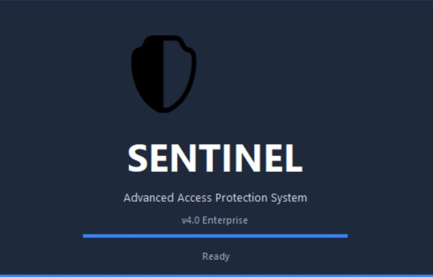

The first element shown at launch: shield logo, product name, tagline and an
animated progress bar with five status messages. It confirms Python compatibility,
creates data directories and reports whether the camera subsystem is available —
so the user knows before setup which controls will function.

### Figure 2 — Setup wizard, step 1: welcome

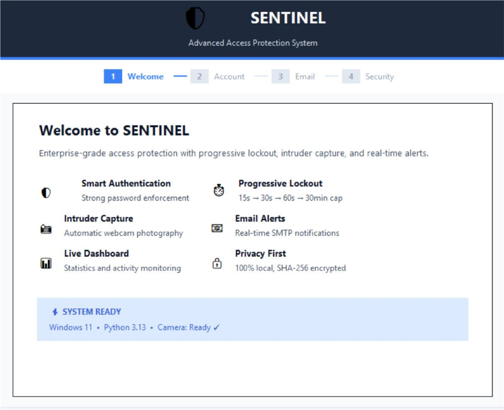

Introduces the six capability tiles (smart authentication, progressive lockout,
intruder capture, email alerts, live dashboard, privacy-first design) and a
"System Ready" banner showing the detected Windows version, Python version and
camera status.

### Figure 3 — Setup wizard, step 2: account creation

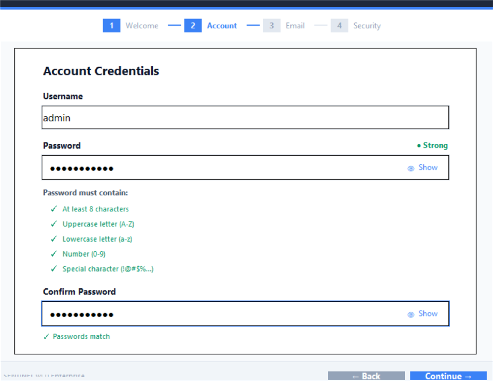

Username, masked password with show/hide toggle, and a live five-item requirement
checklist that turns grey → green as each rule is satisfied. A strength label
(Weak / Medium / Strong) sits beside the heading. The confirm field prevents
typos that would otherwise make the account unreachable.

### Figure 4 — Setup wizard, step 3: email alerts

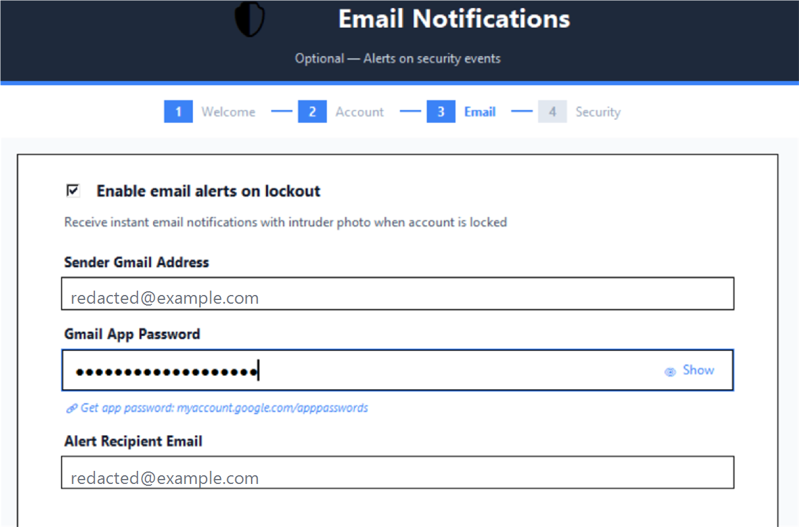

Optional alerts. When enabled, three fields activate: sender Gmail address, Gmail
app password (masked) and recipient address, plus a link explaining how to obtain
an app password. Disabled fields stay greyed out. *(Address redacted in this
figure.)*

### Figure 5 — Setup wizard, step 4: security policy

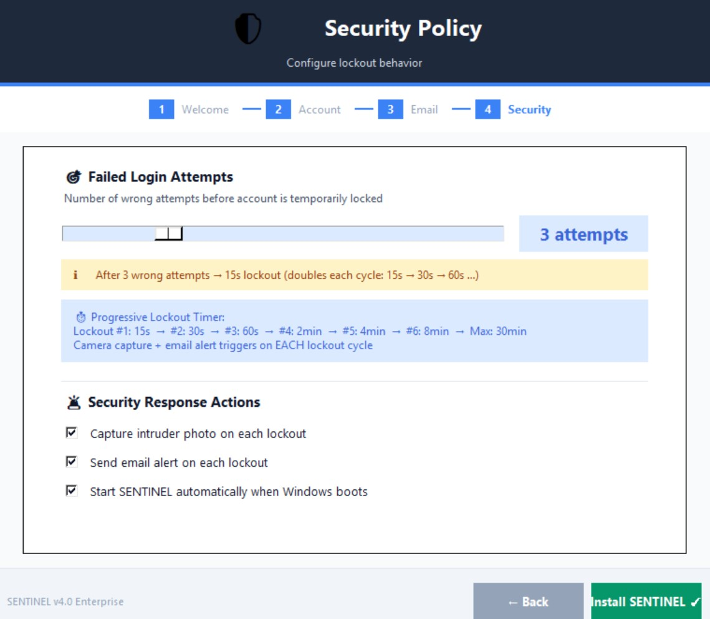

A slider sets the failure threshold (1–10), an information banner explains the
lockout sequence, and three checkboxes control capture, emailing and auto-start.
This is where the security/usability trade-off is made explicit.

### Figure 6 — Installation complete

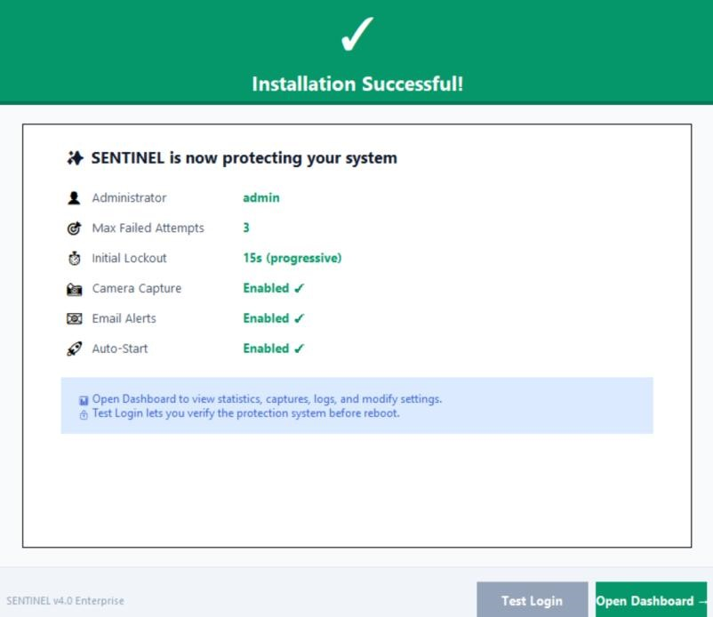

A confirmation receipt listing the administrator account, attempt threshold,
initial lockout duration, and the status of capture, email and auto-start, with
buttons to launch the dashboard or immediately test the login screen.

### Figure 7 — Login screen

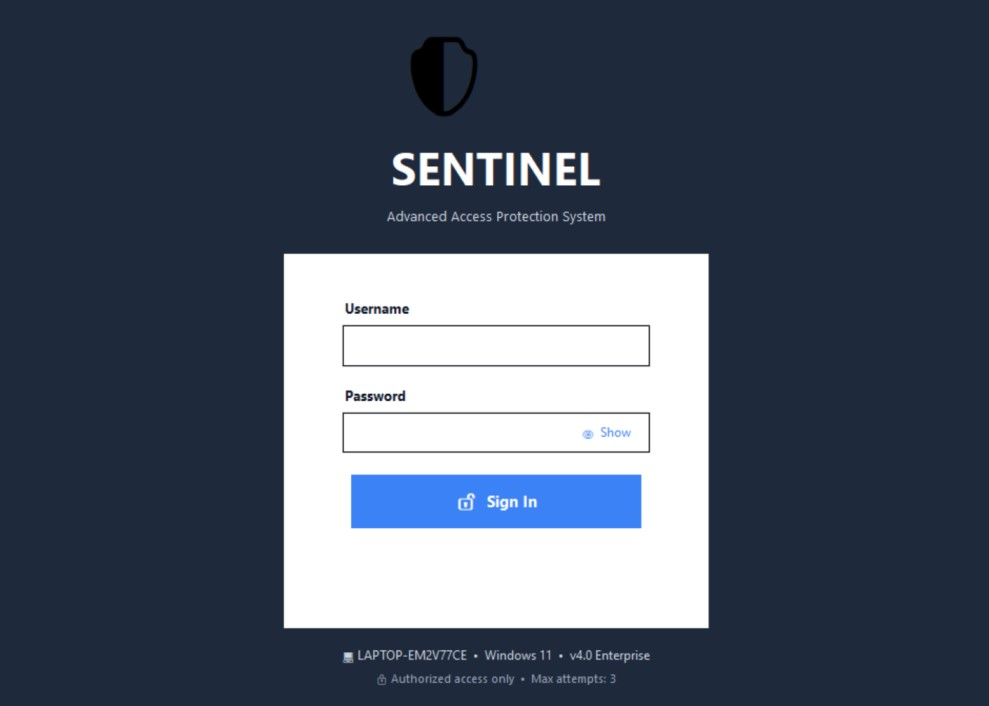

Full screen, no window decoration or taskbar access. The footer shows the computer
name, Windows version and maximum attempts, reinforcing that the session is
monitored.

### Figure 8 — Final-attempt warning

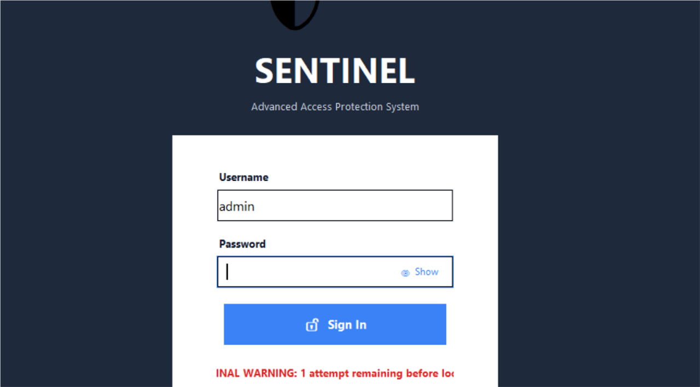

With one attempt left, the status line switches to a bold red "FINAL WARNING".
Earlier failures use amber. The escalation protects the legitimate user from an
accidental lockout while signalling to an intruder that the pattern has been
detected.

### Figure 9 — First lockout

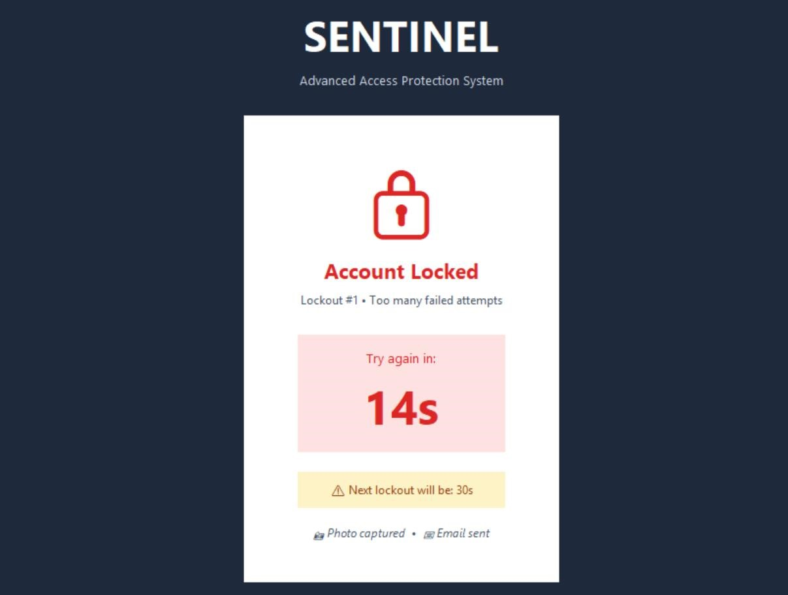

The card becomes a red padlock with the lockout number and a live countdown, plus
a note about the next cycle's duration. Capture and email status are reported at
the bottom of the card.

### Figure 10 — Escalated lockout

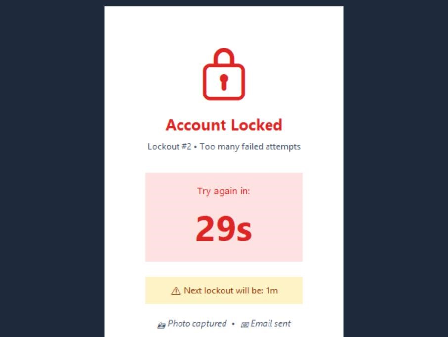

A second cycle shows a longer countdown and an incremented lockout number. Each
cycle produces a fresh capture and alert, building an evidence trail.

### Figure 11 — Successful authentication

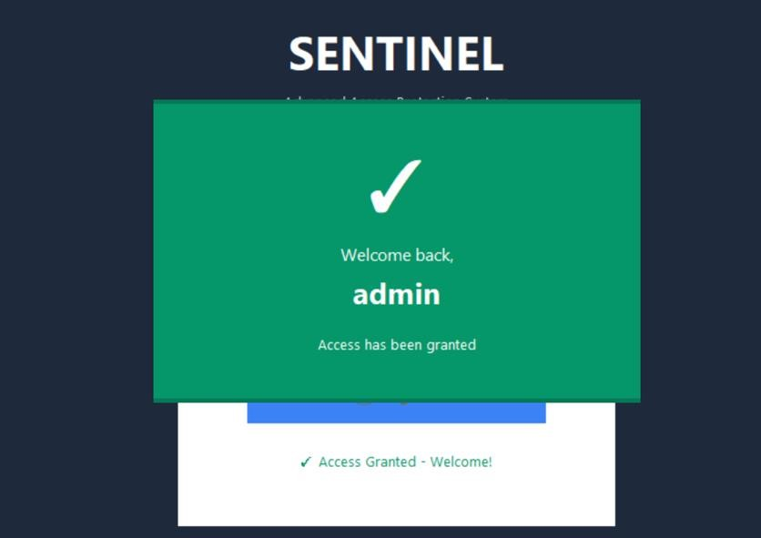

A green overlay confirms the account and closes automatically after 2.5 seconds
before the dashboard opens. Statistics and the audit log are updated at this point.

### Figure 12 — Dashboard overview

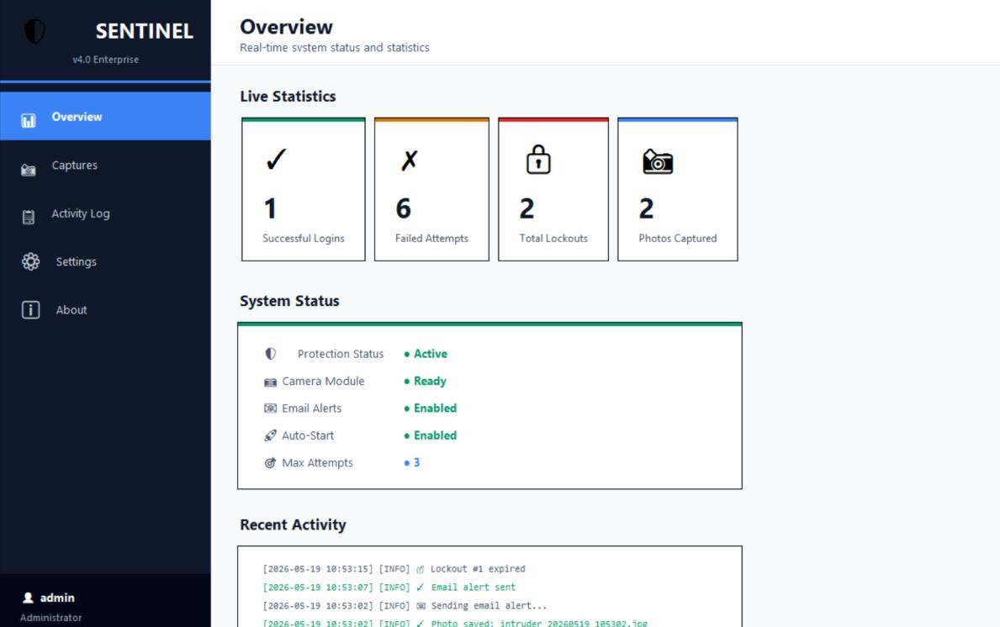

Four statistic cards (successful logins, failed attempts, total lockouts, photos
captured), a system status panel (protection, camera, email, auto-start, maximum
attempts) and the eight most recent log entries.

### Figure 13 — Intruder capture gallery

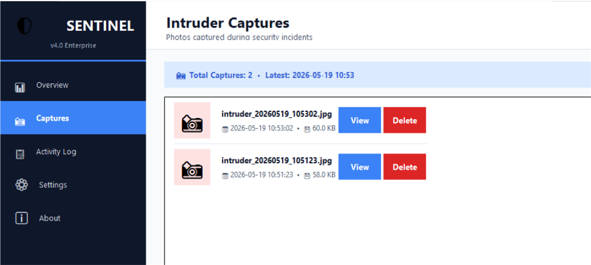

Every lockout photograph with filename, timestamp and size, plus view and delete
actions. This is the evidence archive.

### Figure 14 — Activity log

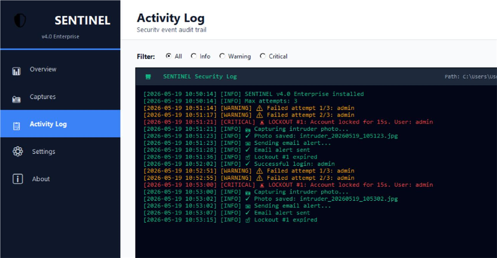

A console-style, colour-coded audit trail with severity filters (All / Info /
Warning / Critical), so a high-severity event can be isolated from routine noise.

### Figure 15 — Settings

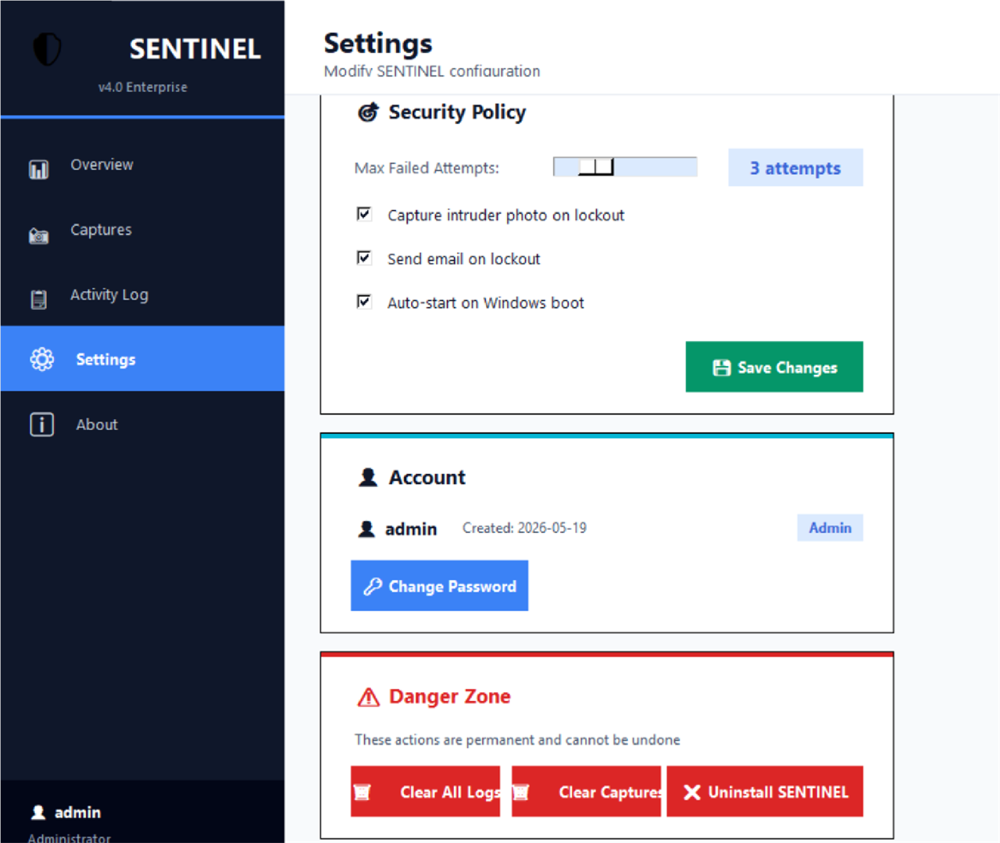

Three sections: security policy (with save), account management (username, creation
date, change password) and a clearly labelled Danger Zone for clearing logs, clearing
captures and uninstalling. Destructive actions require confirmation.

### Figure 16 — Alert received by email

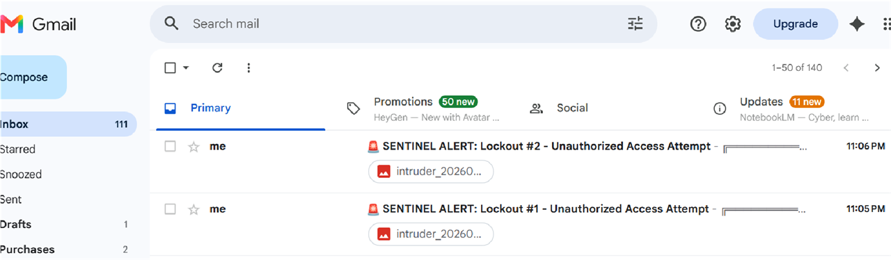

Two lockout alerts in the recipient inbox, each carrying the captured photograph as
an attachment — the end-to-end proof that detection reached the owner's device.

---

## 9. Security review and remediation (v4.1.0)

Before publishing the source, the implementation was reviewed against the OWASP
guidance it claims to follow. Four findings were confirmed and fixed. None changed
the user interface.

| # | Finding (v4.0) | Risk | Fix (v4.1.0) |
| --- | --- | --- | --- |
| 1 | Passwords stored as a single unsalted SHA-256 digest | A copied `config.json` allows offline cracking at billions of guesses per second; identical passwords share a digest | PBKDF2-HMAC-SHA256, 310,000 iterations, 16-byte random salt, constant-time compare, automatic migration |
| 2 | Gmail app password stored in plaintext in `config.json` | Anyone reading the file, or any backup/sync copy, obtains a working credential | DPAPI encryption bound to the Windows account (`dpapi:` prefix), plaintext fallback only if the OS call fails |
| 3 | `pip install opencv-python` executed silently at startup | Supply-chain exposure and code execution on launch; hard failure on offline or locked-down hosts | Removed entirely; dependency declared in `requirements.txt`; capture degrades gracefully |
| 4 | Password comparison with `==` | Timing side channel on hash comparison | `hmac.compare_digest` |

### 9.1 Why this section exists

Reporting only the finished design would hide the most instructive part of the
project. Findings 1 and 2 are the two mistakes most commonly made by
student-built authentication systems, and both were present in a codebase that
already claimed password hashing and email alerting. Recognising that a control
exists is not the same as verifying that it is correct.

### 9.2 Verification

Thirteen unit tests cover the properties that matter: hash format, per-user salt
uniqueness, correct and incorrect verification, malformed input, legacy-hash
migration, the five policy rules, strength labelling, DPAPI round-trip,
idempotent protection and plaintext pass-through. The suite runs on Windows for
Python 3.9 and 3.12 in GitHub Actions.

```powershell
python -m unittest discover -s tests -v
```

---

## 10. Testing and validation

| Area | Method | Result |
| --- | --- | --- |
| Password policy | Unit tests over weak and strong candidates | Five rules enforced independently |
| Hashing | Format, salt uniqueness, verification, malformed input | Pass |
| Legacy migration | SHA-256 digest verified once, replaced on login | Pass |
| Secret storage | DPAPI encrypt → decrypt round-trip, ciphertext inspection | Pass |
| Lockout maths | Manual runs across eight cycles | 15 s → 30 min cap confirmed |
| Capture | Three backends, with and without a camera present | Degrades cleanly when absent |
| Alerting | Live Gmail submission with attachment | Delivered (Figure 16) |
| UI | Manual walkthrough of every screen | Matches Figures 1–15 |

---

## 11. Limitations

SENTINEL is a deterrent and an audit trail, **not** a security boundary.

- **A local administrator can bypass it.** Terminate the process, edit the registry
  or boot into Safe Mode. It protects against casual access, not a determined
  attacker with physical control.
- **Application layer only.** It is not a boot-time driver and does not integrate
  with Windows logon.
- **Captures are unencrypted files.** Protect the volume (BitLocker) if the
  photographs are sensitive.
- **Tkinter is not a hardened secure desktop.** A same-integrity process can
  interact with it.
- **Webcam capture requires consent.** Use only on hardware you own or are
  authorised to monitor; local law may prohibit capturing people.
- **The lockout counter is per process.** Restarting the application resets it.

---

## 12. Future work

1. Persist the lockout counter so a restart does not clear it.
2. Encrypt captures at rest with DPAPI or an OS key store.
3. Windows Credential Manager instead of a JSON file for secrets.
4. Optional TOTP second factor.
5. Signed, packaged executable (PyInstaller + code signing) with a reproducible
   build.
6. Structured JSON logs plus export for SIEM ingestion.
7. Integrity check of `config.json` to detect tampering.

---

## 13. Conclusion

SENTINEL demonstrates the integration of multiple security principles into one
cohesive Windows desktop application: a multi-step setup wizard, enforced password
policy with live feedback, adaptive password hashing, a full-screen progressive
lockout gate, webcam-based intruder capture, real-time SMTP alerting and an
administrative dashboard with an audit trail.

The most valuable outcome was not the feature list but the review. Building the
lockout, the capture and the alerting is engineering; discovering that the password
storage and the credential handling were wrong — and fixing both without breaking
existing accounts — is security work. The 4.1.0 release exists because the first
version was not good enough to publish, and knowing the difference is the point.

SENTINEL is positioned honestly: an educational prototype that shows what
application-layer controls can achieve and where their boundaries lie. The
limitations in §11 are explicit, and §12 sets out the path to production-grade
hardening.

---

## References

1. Python Software Foundation. (2024). *hashlib — Secure hashes and message
   digests*. https://docs.python.org/3/library/hashlib.html
2. Python Software Foundation. (2024). *hmac — Keyed-hashing for message
   authentication*. https://docs.python.org/3/library/hmac.html
3. OpenCV contributors. (2024). *OpenCV documentation*. https://docs.opencv.org
4. Python Software Foundation. (2024). *smtplib — SMTP protocol client*.
   https://docs.python.org/3/library/smtplib.html
5. Python Software Foundation. (2024). *winreg — Windows registry access*.
   https://docs.python.org/3/library/winreg.html
6. Microsoft Corporation. (2024). *CryptProtectData function (dpapi.h)*.
   https://learn.microsoft.com/windows/win32/api/dpapi/nf-dpapi-cryptprotectdata
7. Microsoft Corporation. (2024). *Run and RunOnce registry keys*.
   https://learn.microsoft.com/windows/win32/setupapi/run-and-runonceregistry-keys
8. Google LLC. (2024). *Sign in with App Passwords*.
   https://myaccount.google.com/apppasswords
9. OWASP Foundation. (2023). *Password Storage Cheat Sheet*.
   https://cheatsheetseries.owasp.org/cheatsheets/Password_Storage_Cheat_Sheet.html
10. National Institute of Standards and Technology. (2017). *NIST SP 800-63B:
    Digital Identity Guidelines — Authentication and Lifecycle Management*.
11. Stallings, W. (2022). *Cryptography and Network Security: Principles and
    Practice* (8th ed.). Pearson.
12. Anderson, R. (2020). *Security Engineering: A Guide to Building Dependable
    Distributed Systems* (3rd ed.). Wiley.

---

## Appendix A — Progressive lockout reference

| Lockout # | Formula | Duration | Time to retry |
| --- | --- | --- | --- |
| 1 | 15 × 2⁰ | 15 s | ~15 s |
| 2 | 15 × 2¹ | 30 s | ~30 s |
| 3 | 15 × 2² | 60 s | ~1 min |
| 4 | 15 × 2³ | 120 s | ~2 min |
| 5 | 15 × 2⁴ | 240 s | ~4 min |
| 6 | 15 × 2⁵ | 480 s | ~8 min |
| 7 | 15 × 2⁶ | 960 s | ~16 min |
| 8+ | min(15 × 2ⁿ, 1800) | 1800 s | 30 min (cap) |

---

<sub>End of report · SENTINEL v4.1.0 · Muhammad Jameel</sub>
